<!--
ROSEWOOD FANTASY · README de perfil
DISEÑO: assets/rosewood-header.svg, section-*.svg, project-*.svg y rosewood-footer.svg.
Todos los gráficos son SVG locales y no necesitan servicios externos.
Para añadir un proyecto: duplica un project-N.svg, edita los textos y añade
su imagen con enlace en la sección «Proyectos». Usa solo enlaces reales.
Los SVG contienen colores y tipografías compartidos; consulta la guía en
assets/README-DISENO.md antes de modificarlos.
El portfolio y TeaApp se omiten hasta disponer de enlaces confirmados.
-->

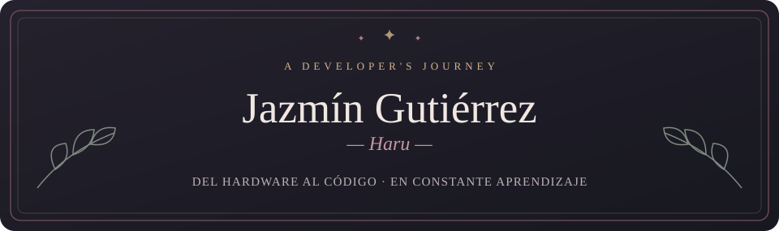

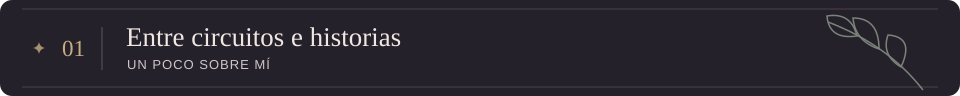

Hola, soy **Jazmín**, aunque en internet también me encontrarás como **Haru**. Mi camino empezó entre hardware, redes y robótica, y ahora continúa en el desarrollo de aplicaciones multiplataforma. Me gusta comprender cómo funcionan las cosas, desde los circuitos hasta el código que les da vida.

Soy **técnica en Sistemas Microinformáticos y Redes** y actualmente estudio **Desarrollo de Aplicaciones Multiplataforma**. Me interesan especialmente los videojuegos, la mecatrónica y los proyectos en los que puedo unir lógica y creatividad.

> Cada proyecto es una página nueva de algo que todavía estoy aprendiendo a construir.

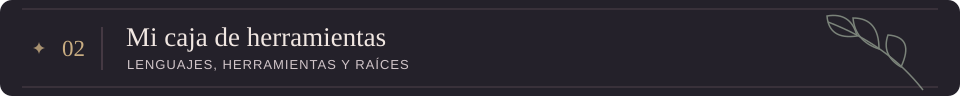

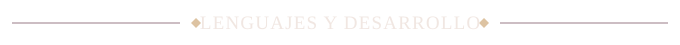

 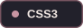 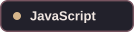    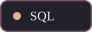   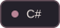

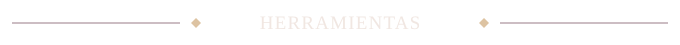

 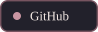  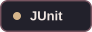     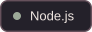

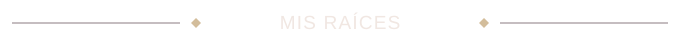

Sistemas · Redes · Hardware · Robótica

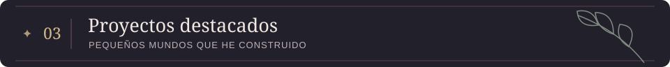

Cuatro proyectos, cuatro maneras de seguir explorando. Pulsa sobre cualquier tarjeta para visitar su repositorio. La estructura está preparada para incorporar nuevos capítulos.

<a href="https://github.com/Haru-jzmPRG/proyecto-juego-js">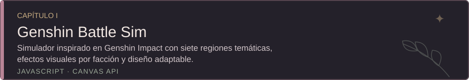</a>

<a href="https://github.com/Haru-jzmPRG/hogwarts_castle">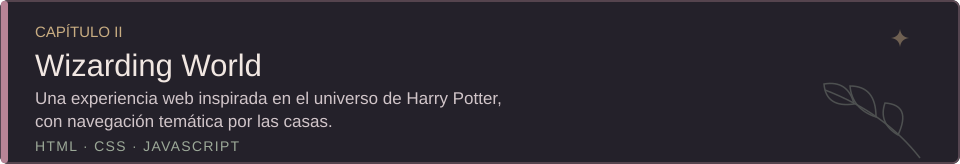</a>

<a href="https://github.com/Haru-jzmPRG/Spock-Game">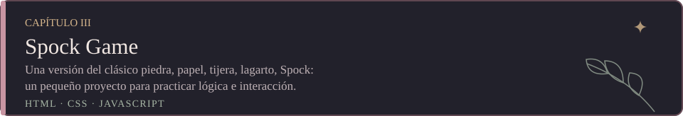</a>

<a href="https://github.com/Haru-jzmPRG/calculadora">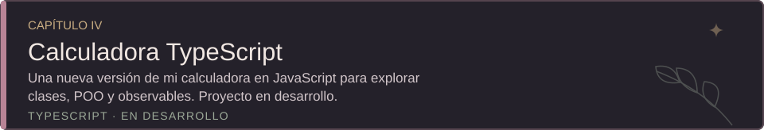</a>

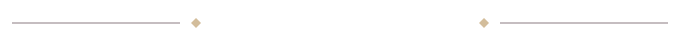

<!-- PROYECTO FUTURO: TeaApp. Añádelo cuando tengas URL real. -->

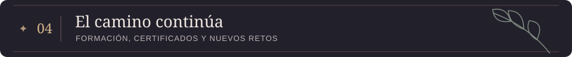

**Formación** · Técnica en Sistemas Microinformáticos y Redes (finalizada) · Desarrollo de Aplicaciones Multiplataforma (en curso).

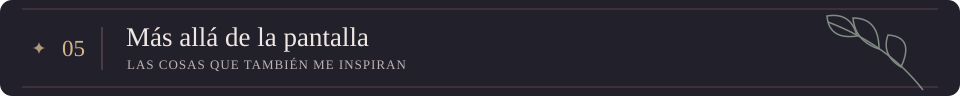

Cuando cierro el editor, me encontrarás jugando **voleibol**, leyendo, escuchando música o descubriendo mundos en algún **videojuego**. Me gusta pensar que esa curiosidad también acompaña a los proyectos que creo.

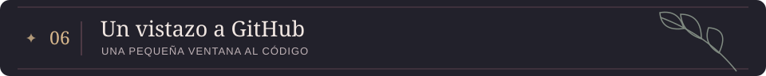

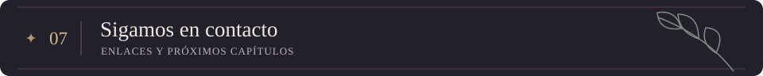

<a href="mailto:programajazminc20@gmail.com">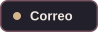</a>

<!-- PORTFOLIO: añade aquí el badge solo cuando tengas una URL pública real. -->

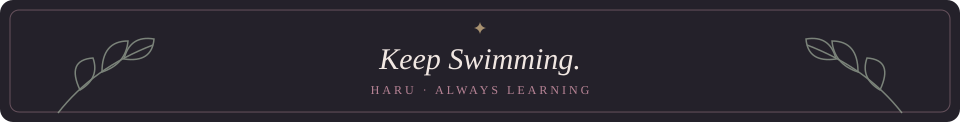

