<!--
╔══════════════════════════════════════════════════════════════════════╗
║  README DE PERFIL · Jazmín Gutiérrez (Haru) · github.com/Haru-jzmPRG  ║
║  Concepto: Rosewood Fantasy · «Libro de aventuras» con estrellas      ║
╚══════════════════════════════════════════════════════════════════════╝

DÓNDE VA CADA COSA (repositorio Haru-jzmPRG/Haru-jzmPRG)
  README.md                         ← este archivo (en la raíz)
  assets/header-dark.svg            ← cabecera para el tema oscuro de GitHub
  assets/header-light.svg           ← cabecera para el tema claro de GitHub
  assets/divider.svg                ← separador de estrellas (sirve en ambos temas)
  assets/certificados/*.pdf         ← tus certificados (nombres exactos más abajo)

GUÍA RÁPIDA DE MANTENIMIENTO
  · Añadir un proyecto  → copia un bloque «PROYECTO» de la sección III y pega
                          el nuevo debajo del último. Cambia nombre, texto,
                          tecnologías y enlace. Nada más.
  · Cambiar tecnologías → edita las líneas con `código` de la sección II.
  · Añadir certificado  → añade una línea a la lista de la sección IV y sube el PDF.
  · Portfolio           → busca «PORTFOLIO» en el Epílogo y quita los comentarios.
  · Textos de la cabecera (escritura y subtítulo) → están DENTRO de los SVG
    de assets/. Se editan con cualquier editor de texto (busca el texto y cámbialo).
    Si cambias el largo de una frase tipeada, hay que ajustar su `textLength`.

REGLA DE ORO: solo enlaces reales. Si todavía no existe, déjalo comentado.
-->

<!-- CABECERA: cambia sola entre tema claro y oscuro. El texto alternativo describe todo el contenido. -->
<picture>
  <source media="(prefers-color-scheme: dark)" srcset="assets/header-dark.svg">
  <source media="(prefers-color-scheme: light)" srcset="assets/header-light.svg">
  
</picture>

<!-- ÍNDICE: los enlaces apuntan a los títulos de abajo. Si cambias un título, cambia aquí el enlace
     (regla: minúsculas, espacios → guiones, sin signos de puntuación salvo guiones). -->

[I. Sobre mí](#i-sobre-mí) · [II. Caja de herramientas](#ii-caja-de-herramientas) · [III. Proyectos](#iii-proyectos) · [IV. Camino recorrido](#iv-camino-recorrido) 
[V. Próximos capítulos](#v-próximos-capítulos) · [VI. Fuera del código](#vi-fuera-del-código) · [VII. Estadísticas](#vii-estadísticas) · [Epílogo](#epílogo)

<!-- ═══════════════════════════ I. SOBRE MÍ ═══════════════════════════ -->

## I. Sobre mí

Hola, soy Jazmín, aunque por aquí me conocen como **Haru**. Empecé entre redes, hardware y robótica, y de ahí di el salto al código. Soy técnica en Sistemas Microinformáticos y Redes y ahora estudio Desarrollo de Aplicaciones Multiplataforma. Me interesan las aplicaciones, los videojuegos y la mecatrónica, y me gusta entender cómo encaja todo, desde el circuito hasta la pantalla.

Este perfil es un libro a medio escribir: cada proyecto es un capítulo.

<!-- ═════════════════════ II. CAJA DE HERRAMIENTAS ═════════════════════ -->
<!-- Las «etiquetas» son código en línea (`así`): no dependen de ningún servicio externo.
     Para añadir una tecnología, escribe `Nombre` junto a las demás. -->

## II. Caja de herramientas

**Lo que uso** 
`HTML` `CSS` `JavaScript` `TypeScript` `Java` `Git` `GitHub` `VS Code` `JUnit`

**Mis raíces** 
Sistemas, redes y hardware

**Diseño** 
`Figma` (certificada)

**Próximamente** 
`Android` `C#` `JavaScript avanzado`

<!-- ═══════════════════════════ III. PROYECTOS ═══════════════════════════ -->
<!-- Tarjetas verticales (sin tablas) para que se lean bien en móvil.
     Cada proyecto es un bloque que empieza por «> ### Nombre».
     PARA AÑADIR UNO: copia un bloque completo (desde «> ### » hasta la línea del enlace),
     pégalo debajo del último y cambia los datos.

     Plantilla:
     > ### Nombre del proyecto
     > Descripción breve de dos o tres líneas.
     >
     > `Tecnología 1` `Tecnología 2`
     >
     > [Ver repositorio →](https://github.com/Haru-jzmPRG/nombre-del-repo)

     Pendiente (comentado hasta que se pueda mostrar): TeaApp. -->

## III. Proyectos

<!-- PROYECTO 1 -->

> ### Genshin Battle Sim
>
> Simulador de batallas inspirado en Genshin Impact, con 7 regiones temáticas, efectos visuales por facción y diseño responsive.
>
> `JavaScript` `Canvas API`
>
> [Ver repositorio →](https://github.com/Haru-jzmPRG/proyecto-juego-js)

<!-- PROYECTO 2 -->

> ### Wizarding World
>
> Página temática del universo de Harry Potter, con diseño inmersivo y navegación por casas.
>
> `HTML` `CSS` `JavaScript`
>
> [Ver repositorio →](https://github.com/Haru-jzmPRG/hogwarts_castle)

<!-- PROYECTO 3 -->

> ### Spock-Game
>
> Juego basado en la variante Piedra, Papel, Tijera, Lagarto, Spock.
>
> `HTML` `CSS` `JavaScript`
>
> [Ver repositorio →](https://github.com/Haru-jzmPRG/Spock-Game)

<!-- PROYECTO 4 · EN DESARROLLO
     Cuando esté terminada, quita «· en desarrollo» del título y ajusta la descripción. -->

> ### Calculadora en TypeScript · _en desarrollo_
>
> Mi calculadora en JavaScript, reescrita en TypeScript para practicar programación orientada a objetos: clases, observables y una lógica mejor organizada.
>
> `TypeScript`
>
> [Ver repositorio →](https://github.com/Haru-jzmPRG/calculadora) · [Versión anterior en JavaScript →](https://github.com/Haru-jzmPRG/Calculadora_js)

<!-- TEAAPP (pendiente: no se puede mostrar todavía en GitHub)
     Cuando esté disponible, descomenta y añade el enlace real del repositorio:
> ### TeaApp
> Descripción real de la app.
>
> `Tecnologías verificadas`
>
> [Ver repositorio →](URL-REAL-AQUÍ)
-->

<!-- ═════════════════════════ IV. CAMINO RECORRIDO ═════════════════════════ -->
<!-- CERTIFICADOS: sube los PDF a assets/certificados/ con estos nombres exactos.
     Hasta que los subas, los enlaces darán error 404.
       assets/certificados/javascript-intermedio.pdf
       assets/certificados/typescript.pdf
       assets/certificados/figma.pdf
     Para añadir uno nuevo: sube su PDF y añade una línea a la lista. -->

## IV. Camino recorrido

**Formación**

- Técnica en Sistemas Microinformáticos y Redes (completada)
- Desarrollo de Aplicaciones Multiplataforma (en curso)

**Certificaciones · OpenWebinars**

- [JavaScript Fundamentos](assets/certificados/certificado_fundamentos_de_javascript.pdf)
- [TypeScript](assets/certificados/certificado_typescript.pdf)
- [Figma](assets/certificados/certificado_curso_de_figma.pdf)

<!-- ═══════════════════════ V. PRÓXIMOS CAPÍTULOS ═══════════════════════ -->
<!-- Son objetivos, no logros: no se presentan como certificaciones. -->

## V. Próximos capítulos

- Android
- C#
- JavaScript avanzado
- Terminar la calculadora en TypeScript

<!-- ════════════════════════ VI. FUERA DEL CÓDIGO ════════════════════════ -->

## VI. Fuera del código

Cuando no estoy delante del editor, probablemente esté jugando voleibol, leyendo historias de fantasía, escuchando música de cualquier estilo o metida en algún videojuego. Me gustan los mundos imaginarios, y creo que eso se nota en lo que construyo.

<!-- ═════════════════════════ VII. ESTADÍSTICAS ═════════════════════════ -->
<!-- Tarjeta pequeña y deliberadamente discreta.
     OJO: viene de un servicio externo (github-readme-stats en Vercel). Si algún día
     deja de cargar, GitHub mostrará el texto alternativo; entonces puedes borrar
     este bloque sin que se rompa nada más.
     Parámetros útiles: langs_count (cuántos lenguajes), hide=batchfile (oculta uno). -->

## VII. Estadísticas

<!-- ═══════════════════════════════ EPÍLOGO ═══════════════════════════════ -->
<!-- CONTACTO: el correo no se repite aquí porque ya aparece en el menú lateral del perfil.
     PORTFOLIO: cuando esté listo, quita los signos de comentario de la línea de abajo
     y pon la URL real (nunca «#»):
     · [Portfolio](URL-REAL-AQUÍ) -->

## Epílogo

[LinkedIn](https://www.linkedin.com/in/jazmin-gutierrez-8445752bb)

<!-- · [Portfolio](URL-REAL-AQUÍ) -->

 

_Keep Swimming._

